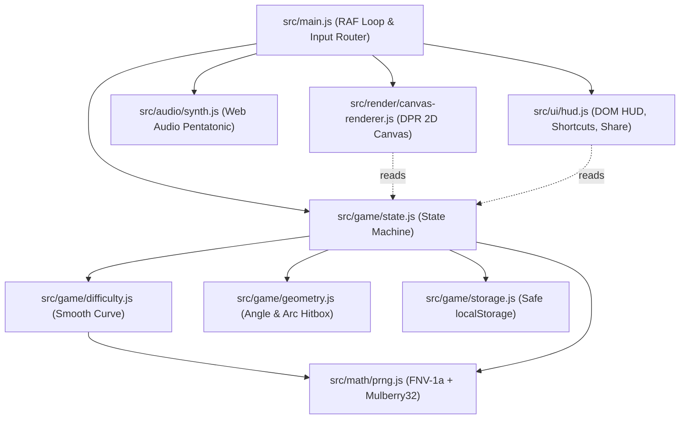

# PULSE RING Implementation Plan

> **For agentic workers:** REQUIRED SUB-SKILL: Use superpowers:subagent-driven-development (recommended) or superpowers:executing-plans to implement this plan task-by-task. Steps use checkbox (`- [ ]`) syntax for tracking.

**Goal:** Build **PULSE RING**, a zero-dependency, high-DPI, frame-rate-independent concentric ring timing game with Endless & deterministic Daily Challenge modes, Light/Dark theme parity, procedural Web Audio, WCAG AA accessibility, and GitHub Pages CI deployment.

**Architecture:** A strict functional core (`src/math/`, `src/game/`) holds deterministic seeded PRNG, circular wrap-around collision geometry, smooth asymptotic difficulty generation, safe `localStorage` persistence, and a frame-rate-independent state machine. An imperative shell (`src/audio/`, `src/render/`, `src/ui/`, `src/main.js`) drives the DPR-scaled HTML5 Canvas, Web Audio pentatonic synthesizer, accessible DOM HUD, and input routing with zero external dependencies.

**Architecture Diagram:**



**Tech Stack:** Vanilla HTML5, Modern CSS (Custom Properties, Grid, `prefers-color-scheme`, `prefers-reduced-motion`), ES Modules (`src/`), HTML5 2D Canvas (`devicePixelRatio`), Procedural Web Audio API, Node v24 built-in `node --test` runner, GitHub Actions Pages workflow.

**Spec:** [DESIGN.md](file:///e:/projects/pulse-ring/DESIGN.md)

## Global Constraints

- Zero external dependencies, CDNs, frameworks, or bundlers; all URLs and ES module imports use relative `./` paths for GitHub Pages subpath safety.
- Frame-rate independent physics using clamped delta time (`dt <= 0.05s`) in seconds so 60Hz, 120Hz, and 144Hz monitors share identical orbital speeds.
- Exact Dark Mode palette (`#0F1117` ground, `#CBD5E1` rings, `#F59E0B` target arc, `#FB7185` orb/trail) and Light Mode palette (`#F6F4EF` ground, `#2B2E38` rings, `#D97706` target arc, `#E11D48` orb/trail) with WCAG AA text contrast (`>= 4.5:1`).
- Smooth difficulty progression: L1–2 `2` rings & same spin; L3–5 `+4%` speed/level & alternating inner spin; L6–10 `3` rings & subtle outer arc drift/breathing; L11+ `3–4` rings & asymptotic speed cap (`3.30 rad/s`), arc floor (`0.46 rad`).
- `touch-action: none` on the play canvas, `44px × 44px` minimum tap targets on HUD buttons, full keyboard navigation (`Space`/`Enter`, `M`, `T`, `D`, `?`, `Escape`), and `prefers-reduced-motion` support.
- Instant 1-tap or `Space` retry on miss (`160ms` bounce guard, zero blocking modals); Daily mode uses UTC `YYYY-MM-DD` deterministic seed and provides 1-click `"Share Result"` copy.

## Review Focus

1. **Wrap-around collision across the `0 / 2π` seam:** Orbs or target arcs centered near `0` or `2π` must evaluate signed shortest angular distance accurately without falsely missing across the branch cut.
2. **Tab-switch / frame-freeze `dt` spike:** Switching browser tabs or pausing must clamp `dt` (`<= 0.05s`) and freeze simulation when `document.hidden` or the `?` rules popover is open so the orb never teleports into a miss.
3. **HUD button focus hijacking `Space`:** Clicking Mute, Theme, Daily, or `?` with a mouse/touch must blur pointer focus (`if (e.detail > 0)`) so pressing `Space` immediately afterward snaps the orb rather than re-toggling the button, while keeping `Tab` + `Enter`/`Space` intact for keyboard users.
4. **Restricted `localStorage` or `AudioContext` / `navigator.clipboard`:** Safari private mode, blocked audio autoplay, or denied clipboard permissions must degrade gracefully without throwing uncaught exceptions or locking the game.
5. **High-DPR & narrow/landscape viewport resize:** Canvas resizing from `1280×800` desktop to `375×667` portrait or `667×375` landscape must keep concentric rings centered, crisp (`devicePixelRatio`), and non-overlapping with the top HUD or bottom footer.

---

### Task 1: Deterministic Seeded PRNG & Circular Wrap-Around Geometry

**Files:**
- Create: `src/math/prng.js`
- Create: `src/game/geometry.js`
- Test: `tests/prng.test.js`
- Test: `tests/geometry.test.js`

**Interfaces:**
- Produces in `src/math/prng.js`:
  - `fnv1a32(input: string): number`
  - `createSeededRng(seedStr: string): () => number` (yields deterministic floats in `[0, 1)`)
  - `getDailyDateKey(date?: Date): string` (returns UTC `'YYYY-MM-DD'`)
  - `createLevelRng(mode: 'endless' | 'daily', level: number, seedKey: string): () => number`
- Produces in `src/game/geometry.js`:
  - `TWO_PI: number`
  - `normalizeAngle(angle: number): number` (in `[0, 2π)`)
  - `shortestSignedAngleDiff(a: number, b: number): number` (in `[-π, π)`)
  - `evaluateSnap(orbAngle: number, arcCenter: number, arcWidth: number, perfectRatio?: number, edgeTolerance?: number): { outcome: 'perfect' | 'hit' | 'miss', delta: number, signedDelta: number }`

- [ ] **Step 1: Write failing tests for PRNG and circular geometry**

Create `tests/prng.test.js`:
```js
import { describe, it } from 'node:test';
import assert from 'node:assert/strict';
import { fnv1a32, createSeededRng, getDailyDateKey, createLevelRng } from '../src/math/prng.js';

describe('prng', () => {
  it('produces identical sequence for identical seeds and diverges for different seeds', () => {
    const a1 = createSeededRng('pulse-ring:2026-11-11:level:1');
    const a2 = createSeededRng('pulse-ring:2026-11-11:level:1');
    const b = createSeededRng('pulse-ring:2026-11-12:level:1');

    const seqA1 = Array.from({ length: 8 }, () => a1());
    const seqA2 = Array.from({ length: 8 }, () => a2());
    const seqB = Array.from({ length: 8 }, () => b());

    assert.deepEqual(seqA1, seqA2);
    assert.notDeepEqual(seqA1, seqB);
    for (const n of seqA1) {
      assert.ok(n >= 0 && n < 1, `Expected [0,1), got ${n}`);
    }
  });

  it('formats UTC YYYY-MM-DD daily date keys deterministically', () => {
    assert.equal(getDailyDateKey(new Date('2026-11-11T23:55:00Z')), '2026-11-11');
    assert.equal(getDailyDateKey(new Date('2026-01-05T00:10:00Z')), '2026-01-05');
  });

  it('derives independent deterministic level streams per (mode, level, seedKey)', () => {
    assert.equal(typeof fnv1a32('pulse'), 'number');
    const r1 = createLevelRng('daily', 4, '2026-11-11');
    const r2 = createLevelRng('daily', 4, '2026-11-11');
    const r3 = createLevelRng('daily', 5, '2026-11-11');
    assert.equal(r1(), r2());
    assert.notEqual(r1(), r3());
  });
});
```

Create `tests/geometry.test.js`:
```js
import { describe, it } from 'node:test';
import assert from 'node:assert/strict';
import { TWO_PI, normalizeAngle, shortestSignedAngleDiff, evaluateSnap } from '../src/game/geometry.js';

describe('geometry', () => {
  it('normalizes negative and overflow angles into [0, 2pi)', () => {
    assert.ok(Math.abs(normalizeAngle(-Math.PI / 2) - 1.5 * Math.PI) < 1e-9);
    assert.ok(Math.abs(normalizeAngle(TWO_PI + 0.4) - 0.4) < 1e-9);
    assert.equal(normalizeAngle(TWO_PI), 0);
  });

  it('computes shortest signed angular difference across the 0 / 2pi seam', () => {
    const diffA = shortestSignedAngleDiff(0.05, TWO_PI - 0.05);
    assert.ok(Math.abs(diffA - 0.1) < 1e-9);

    const diffB = shortestSignedAngleDiff(TWO_PI - 0.05, 0.05);
    assert.ok(Math.abs(diffB + 0.1) < 1e-9);
  });

  it('evaluates perfect, hit, and miss accurately across the 0 / 2pi wrap boundary', () => {
    const perfect = evaluateSnap(TWO_PI - 0.04, 0.02, 0.8, 0.28);
    assert.equal(perfect.outcome, 'perfect');

    const hit = evaluateSnap(TWO_PI - 0.28, 0.02, 0.8, 0.28);
    assert.equal(hit.outcome, 'hit');

    const miss = evaluateSnap(TWO_PI - 0.55, 0.02, 0.8, 0.28);
    assert.equal(miss.outcome, 'miss');
  });
});
```

- [ ] **Step 2: Run tests to verify they fail**

Run: `node --test tests/prng.test.js tests/geometry.test.js`
Expected: FAIL with `ERR_MODULE_NOT_FOUND` for `../src/math/prng.js` and `../src/game/geometry.js`.

- [ ] **Step 3: Implement `src/math/prng.js` and `src/game/geometry.js`**

Implement `fnv1a32` (offset basis `2166136261`, prime `16777619` with `Math.imul`), `mulberry32` inside `createSeededRng`, UTC `toISOString().slice(0, 10)` in `getDailyDateKey`, and `createLevelRng`. Implement `TWO_PI`, `normalizeAngle`, `shortestSignedAngleDiff` (wrapped into `[-π, π)`), and `evaluateSnap` checking `delta <= halfArc * perfectRatio` -> `'perfect'`, `delta <= halfArc + edgeTolerance` -> `'hit'`, else `'miss'`.

- [ ] **Step 4: Run tests to verify they pass**

Run: `node --test tests/prng.test.js tests/geometry.test.js`
Expected: PASS (all tests green, 0 failures).

- [ ] **Step 5: Commit Task 1**

```bash
git add src/math/prng.js src/game/geometry.js tests/prng.test.js tests/geometry.test.js
git commit -m "feat: add deterministic PRNG and circular arc geometry"
```

---

### Task 2: Smooth Difficulty Progression & Deterministic Level Generator

**Files:**
- Create: `src/game/difficulty.js`
- Test: `tests/difficulty.test.js`

**Interfaces:**
- Consumes: `createLevelRng` from `../math/prng.js`; `normalizeAngle`, `TWO_PI` from `./geometry.js`
- Produces in `src/game/difficulty.js`:
  - `SPEED_CAP = 3.30`
  - `MIN_ARC_WIDTH = 0.46`
  - `getRingCount(level: number): number`
  - `getBaseAngularSpeed(level: number): number`
  - `getArcWidth(level: number, ringIndex?: number): number`
  - `generateLevel(level: number, options?: { mode?: 'endless' | 'daily', seedKey?: string }): { level: number, ringCount: number, rings: Array<{ index: number, radiusRatio: number, angularSpeed: number, direction: 1 | -1, baseArcCenter: number, arcCenter: number, baseArcWidth: number, arcWidth: number, driftAmplitude: number, driftFrequency: number, driftPhase: number, breatheAmplitude: number, orbStartAngle: number }> }`
  - `computeRingArcAtTime(ring: object, elapsed: number): { arcCenter: number, arcWidth: number }`

- [ ] **Step 1: Write failing tests for difficulty progression and deterministic level generation**

Create `tests/difficulty.test.js`:
```js
import { describe, it } from 'node:test';
import assert from 'node:assert/strict';
import {
  SPEED_CAP,
  MIN_ARC_WIDTH,
  getRingCount,
  getBaseAngularSpeed,
  getArcWidth,
  generateLevel,
  computeRingArcAtTime
} from '../src/game/difficulty.js';
import { shortestSignedAngleDiff } from '../src/game/geometry.js';

describe('difficulty progression', () => {
  it('assigns ring counts smoothly across progression tiers', () => {
    assert.equal(getRingCount(1), 2);
    assert.equal(getRingCount(2), 2);
    assert.equal(getRingCount(5), 2);
    assert.equal(getRingCount(6), 3);
    assert.equal(getRingCount(10), 3);
    assert.equal(getRingCount(11), 3);
    assert.equal(getRingCount(13), 4);
    assert.equal(getRingCount(30), 4);
  });

  it('scales +4% per level across levels 3-5 and caps asymptotically below SPEED_CAP', () => {
    const s2 = getBaseAngularSpeed(2);
    const s3 = getBaseAngularSpeed(3);
    const s4 = getBaseAngularSpeed(4);
    const s5 = getBaseAngularSpeed(5);

    assert.ok(Math.abs(s3 / s2 - 1.04) < 1e-6);
    assert.ok(Math.abs(s4 / s3 - 1.04) < 1e-6);
    assert.ok(Math.abs(s5 / s4 - 1.04) < 1e-6);

    let prev = getBaseAngularSpeed(1);
    for (let lvl = 2; lvl <= 120; lvl++) {
      const s = getBaseAngularSpeed(lvl);
      assert.ok(s > prev, `Level ${lvl} speed ${s} should exceed ${prev}`);
      assert.ok(s < SPEED_CAP, `Level ${lvl} speed ${s} must stay under cap ${SPEED_CAP}`);
      prev = s;
    }
  });

  it('keeps arc width above MIN_ARC_WIDTH even at extreme levels', () => {
    assert.ok(getArcWidth(1, 0) > getArcWidth(2, 0));
    assert.ok(getArcWidth(100, 3) >= MIN_ARC_WIDTH);
  });

  it('sets same direction on L1-2, alternating spin on L3+, and outer drift/breathing on L6+', () => {
    const l1 = generateLevel(1, { mode: 'daily', seedKey: '2026-11-11' });
    assert.deepEqual(l1.rings.map((r) => r.direction), [1, 1]);
    assert.equal(l1.rings[0].driftAmplitude, 0);

    const l3 = generateLevel(3, { mode: 'daily', seedKey: '2026-11-11' });
    assert.notEqual(l3.rings[0].direction, l3.rings[1].direction);
    assert.equal(l3.rings[0].driftAmplitude, 0);

    const l7 = generateLevel(7, { mode: 'daily', seedKey: '2026-11-11' });
    assert.equal(l7.rings.length, 3);
    assert.ok(l7.rings[0].driftAmplitude > 0);
    assert.ok(l7.rings[0].breatheAmplitude > 0);
    assert.equal(l7.rings[2].driftAmplitude, 0);

    const shifted = computeRingArcAtTime(l7.rings[0], 1.25);
    assert.notEqual(shifted.arcCenter, l7.rings[0].baseArcCenter);
  });

  it('generates identical daily levels for the same date and keeps orb lead-in fair', () => {
    const a = generateLevel(6, { mode: 'daily', seedKey: '2026-11-11' });
    const b = generateLevel(6, { mode: 'daily', seedKey: '2026-11-11' });
    assert.deepEqual(a, b);

    for (const ring of a.rings) {
      const leadDiff = Math.abs(shortestSignedAngleDiff(ring.orbStartAngle, ring.baseArcCenter));
      assert.ok(leadDiff >= ring.baseArcWidth, `Orb start too close to arc on ring ${ring.index}`);
    }
  });
});
```

- [ ] **Step 2: Run test to verify it fails**

Run: `node --test tests/difficulty.test.js`
Expected: FAIL with `ERR_MODULE_NOT_FOUND`.

- [ ] **Step 3: Implement `src/game/difficulty.js`**

Implement `getRingCount`, `getBaseAngularSpeed` (`L1: 1.55`, `L2: 1.62`, `L3–5: 1.62 * 1.04^(L-2)`, `L6+: SPEED_CAP - (SPEED_CAP - speed5) * Math.exp(-0.052 * (L - 5))`), `getArcWidth` (`L1: 1.36`, `L2: 1.26`, `L3: 1.16`, `L4: 1.08`, `L5: 1.00`, `L6+: MIN_ARC_WIDTH + (1.00 - MIN_ARC_WIDTH) * Math.exp(-0.095 * (L - 5))`, inner ring offset `-0.04 * ringIndex` clamped to `>= MIN_ARC_WIDTH`), `generateLevel` (computing descending `radiusRatio` array cleanly spaced inside `[0.38, 0.94]`, inner ring speed scaling `1 + 0.07 * ringIndex`, alternating direction from `L3+`, drift/breathing on outer rings `L6+`, fair `orbStartAngle` across the ring from `baseArcCenter`), and `computeRingArcAtTime`.

- [ ] **Step 4: Run test to verify it passes**

Run: `node --test tests/difficulty.test.js`
Expected: PASS (all tests green).

- [ ] **Step 5: Commit Task 2**

```bash
git add src/game/difficulty.js tests/difficulty.test.js
git commit -m "feat: add smooth difficulty curve and deterministic level generator"
```

---

### Task 3: Safe Persistence & Game State Machine

**Files:**
- Create: `src/game/storage.js`
- Create: `src/game/state.js`
- Test: `tests/storage.test.js`
- Test: `tests/state.test.js`

**Interfaces:**
- Consumes: `generateLevel`, `computeRingArcAtTime` from `./difficulty.js`; `evaluateSnap`, `normalizeAngle` from `./geometry.js`; `getDailyDateKey` from `../math/prng.js`
- Produces in `src/game/storage.js`:
  - `createStorage(storageImpl?: Storage): { getTheme(prefersDark?: boolean): 'dark' | 'light', setTheme(theme: 'dark' | 'light'): void, getMuted(): boolean, setMuted(muted: boolean): void, getEndlessStats(): { currentLevel: number, bestLevel: number, bestStreak: number }, saveEndlessStats(stats: object): void, getDailyStats(dateKey: string): { bestLevel: number, bestStreak: number, lastLevel: number, lastStreak: number, lastPerfects: number, runsCount: number }, saveDailyStats(dateKey: string, stats: object): void }`
- Produces in `src/game/state.js`:
  - `SNAP_DURATION = 0.14`, `LEVEL_CLEAR_DURATION = 0.26`, `MISS_RETRY_COOLDOWN = 0.16`, `MAX_DT = 0.05`
  - `createGameController(options?: { storage?: object, dateKeyProvider?: () => string, endlessSeed?: string }): GameController`
    - Properties exposed cleanly via `getSnapshot()` or direct state: `mode`, `phase`, `paused`, `level`, `streak`, `runBestStreak`, `bestLevel`, `bestStreak`, `runPerfects`, `hasSnappedOnce`, `activeRingIndex`, `orbAngle`, `rings`, `elapsed`, `phaseTimer`, `missElapsed`, `snapFromRadiusRatio`, `snapToRadiusRatio`, `ripples`, `trail`, `dailyKey`, `dailyStats`
    - Methods: `step(dtSeconds: number)`, `triggerAction()`, `setMode(mode: 'endless' | 'daily')`, `setPaused(paused: boolean)`, `formatDailyShareText(): string`

- [ ] **Step 1: Write failing tests for safe storage and game state machine**

Create `tests/storage.test.js`:
```js
import { describe, it } from 'node:test';
import assert from 'node:assert/strict';
import { createStorage } from '../src/game/storage.js';

describe('storage', () => {
  it('survives throwing or inaccessible localStorage without failing', () => {
    const brokenStorage = {
      getItem() { throw new Error('SecurityError'); },
      setItem() { throw new Error('QuotaExceededError'); }
    };
    const store = createStorage(brokenStorage);
    assert.equal(store.getTheme(true), 'dark');
    assert.equal(store.getTheme(false), 'light');
    assert.equal(store.getMuted(), false);
    assert.deepEqual(store.getEndlessStats(), { currentLevel: 1, bestLevel: 1, bestStreak: 0 });
    store.saveEndlessStats({ currentLevel: 5, bestLevel: 5, bestStreak: 10 });
  });

  it('recovers safely from corrupted JSON in storage', () => {
    const map = new Map([['pulse-ring:endless', '{not-valid-json']]);
    const mock = {
      getItem: (k) => map.get(k) ?? null,
      setItem: (k, v) => map.set(k, v)
    };
    const store = createStorage(mock);
    assert.deepEqual(store.getEndlessStats(), { currentLevel: 1, bestLevel: 1, bestStreak: 0 });
  });
});
```

Create `tests/state.test.js`:
```js
import { describe, it } from 'node:test';
import assert from 'node:assert/strict';
import { createGameController, MAX_DT, MISS_RETRY_COOLDOWN } from '../src/game/state.js';
import { createStorage } from '../src/game/storage.js';

function createMemoryStorage() {
  const map = new Map();
  return createStorage({
    getItem: (k) => map.get(k) ?? null,
    setItem: (k, v) => map.set(k, v)
  });
}

describe('game state controller', () => {
  it('clamps large dt spikes and freezes simulation while paused', () => {
    const game = createGameController({
      storage: createMemoryStorage(),
      dateKeyProvider: () => '2026-11-11',
      endlessSeed: 'test-seed'
    });
    const startAngle = game.state.orbAngle;
    const speed = game.state.rings[0].angularSpeed;

    game.step(5.0); // huge tab-switch spike must clamp to MAX_DT
    const expectedDelta = speed * MAX_DT;
    assert.ok(Math.abs(game.state.orbAngle - startAngle - expectedDelta) < 1e-6);

    game.setPaused(true);
    const pausedAngle = game.state.orbAngle;
    game.step(0.05);
    assert.equal(game.state.orbAngle, pausedAngle);
  });

  it('awards +2 streak on PERFECT, +1 on HIT, advances level after last ring, and persists bests', () => {
    const store = createMemoryStorage();
    const game = createGameController({
      storage: store,
      dateKeyProvider: () => '2026-11-11',
      endlessSeed: 'test-seed'
    });

    // Align orb precisely to ring 0 arcCenter -> PERFECT
    game.state.orbAngle = game.state.rings[0].arcCenter;
    const res1 = game.triggerAction();
    assert.equal(res1.action, 'perfect');
    assert.equal(game.state.streak, 2);
    assert.equal(game.state.hasSnappedOnce, true);

    // Advance past snap animation
    game.step(0.05);
    game.step(0.05);
    game.step(0.05);
    assert.equal(game.state.phase, 'playing');
    assert.equal(game.state.activeRingIndex, 1);

    // Align orb slightly off center (within halfArc, outside perfectRatio) -> HIT
    const r1 = game.state.rings[1];
    game.state.orbAngle = r1.arcCenter + r1.arcWidth * 0.35;
    const res2 = game.triggerAction();
    assert.equal(res2.action, 'hit');
    assert.equal(game.state.streak, 3);
    assert.equal(game.state.phase, 'level_clear');

    // Complete level clear transition
    for (let i = 0; i < 7; i++) game.step(0.05);
    assert.equal(game.state.level, 2);
    assert.equal(game.state.phase, 'playing');
    assert.equal(store.getEndlessStats().currentLevel, 2);
    assert.equal(store.getEndlessStats().bestStreak, 3);
  });

  it('misses gently, respects retry bounce cooldown, and instantly retries Endless level', () => {
    const store = createMemoryStorage();
    store.saveEndlessStats({ currentLevel: 3, bestLevel: 3, bestStreak: 5 });
    const game = createGameController({
      storage: store,
      dateKeyProvider: () => '2026-11-11',
      endlessSeed: 'test-seed'
    });
    assert.equal(game.state.level, 3);
    game.state.streak = 5;
    game.state.orbAngle = game.state.rings[0].arcCenter + Math.PI;
    const missRes = game.triggerAction();
    assert.equal(missRes.action, 'miss');
    assert.equal(game.state.phase, 'missed');
    assert.equal(game.state.streak, 0);

    // Immediate double-tap within bounce cooldown is ignored
    const earlyTap = game.triggerAction();
    assert.equal(earlyTap.action, 'ignored');

    // After cooldown, 1 tap retries level 3 instantly
    for (let i = 0; i < 4; i++) game.step(MISS_RETRY_COOLDOWN / 3);
    const retryRes = game.triggerAction();
    assert.equal(retryRes.action, 'retry');
    assert.equal(game.state.phase, 'playing');
    assert.equal(game.state.level, 3);
    assert.equal(game.state.activeRingIndex, 0);
  });

  it('tracks Daily run independently, restarts Daily at Level 1 after miss, and formats clean Share text', () => {
    const store = createMemoryStorage();
    const game = createGameController({
      storage: store,
      dateKeyProvider: () => '2026-11-11',
      endlessSeed: 'test-seed'
    });

    game.setMode('daily');
    assert.equal(game.state.mode, 'daily');
    assert.equal(game.state.level, 1);

    // Clear Level 1 in Daily
    game.state.orbAngle = game.state.rings[0].arcCenter;
    game.triggerAction();
    for (let i = 0; i < 4; i++) game.step(0.05);
    game.state.orbAngle = game.state.rings[1].arcCenter;
    game.triggerAction();
    for (let i = 0; i < 7; i++) game.step(0.05);
    assert.equal(game.state.level, 2);

    // Miss on Level 2 -> Daily run ends and locks summary
    game.state.orbAngle = game.state.rings[0].arcCenter + Math.PI;
    game.triggerAction();
    assert.equal(game.state.phase, 'missed');
    const share = game.formatDailyShareText();
    assert.match(share, /PULSE RING · Daily 2026-11-11/);
    assert.match(share, /Level 02 · Streak 04 · 2 Perfects/);

    // Retry Daily restarts from Level 1
    for (let i = 0; i < 4; i++) game.step(0.05);
    game.triggerAction();
    assert.equal(game.state.level, 1);
  });
});
```

- [ ] **Step 2: Run tests to verify they fail**

Run: `node --test tests/storage.test.js tests/state.test.js`
Expected: FAIL with `ERR_MODULE_NOT_FOUND`.

- [ ] **Step 3: Implement `src/game/storage.js` and `src/game/state.js`**

Write clean, zero-throw `localStorage` persistence in `src/game/storage.js` and pure/encapsulated state transitions in `src/game/state.js` supporting `playing`, `snapping`, `level_clear`, `missed`, `paused`, `ripples`, tapered `trail` history (max 16 samples), and independent `endless` / `daily` progress.

- [ ] **Step 4: Run tests to verify they pass**

Run: `node --test tests/storage.test.js tests/state.test.js`
Expected: PASS (all tests green).

- [ ] **Step 5: Commit Task 3**

```bash
git add src/game/storage.js src/game/state.js tests/storage.test.js tests/state.test.js
git commit -m "feat: add safe storage wrapper and frame-independent state machine"
```

---

### Task 4: Procedural Web Audio Pentatonic Synthesizer

**Files:**
- Create: `src/audio/synth.js`
- Test: `tests/synth.test.js`

**Interfaces:**
- Produces in `src/audio/synth.js`:
  - `PENTATONIC_HZ: number[]` (`[523.25, 587.33, 659.25, 783.99, 880.0, 1046.5, 1174.66, 1318.51]`)
  - `createAudioSynth(options?: { AudioContextClass?: typeof AudioContext, muted?: boolean }): { unlock(): void, setMuted(muted: boolean): void, isMuted(): boolean, playSnap(streakIndex: number, isPerfect: boolean): void, playLevelClear(level: number): void, playMiss(): void }`

- [ ] **Step 1: Write failing tests for Web Audio synth**

Create `tests/synth.test.js`:
```js
import { describe, it } from 'node:test';
import assert from 'node:assert/strict';
import { createAudioSynth, PENTATONIC_HZ } from '../src/audio/synth.js';

function createMockAudioContextClass() {
  const events = [];
  class MockAudioContext {
    constructor() {
      this.state = 'suspended';
      this.currentTime = 1.0;
      this.destination = {};
    }
    resume() {
      this.state = 'running';
      events.push({ type: 'resume' });
      return Promise.resolve();
    }
    createOscillator() {
      const osc = {
        type: 'sine',
        frequency: {
          setValueAtTime: (v) => events.push({ type: 'freq', v }),
          exponentialRampToValueAtTime: (v) => events.push({ type: 'freqRamp', v })
        },
        connect: () => {},
        start: () => events.push({ type: 'start' }),
        stop: () => events.push({ type: 'stop' })
      };
      return osc;
    }
    createGain() {
      return {
        gain: {
          setValueAtTime: (v) => events.push({ type: 'gain', v }),
          exponentialRampToValueAtTime: (v) => events.push({ type: 'gainRamp', v })
        },
        connect: () => {}
      };
    }
  }
  return { MockAudioContext, events };
}

describe('audio synth', () => {
  it('no-ops gracefully when AudioContext is missing or muted', () => {
    const silent = createAudioSynth({ AudioContextClass: null, muted: false });
    silent.unlock();
    silent.playSnap(0, true);
    silent.playLevelClear(1);
    silent.playMiss();

    const { MockAudioContext, events } = createMockAudioContextClass();
    const muted = createAudioSynth({ AudioContextClass: MockAudioContext, muted: true });
    muted.unlock();
    muted.playSnap(2, true);
    muted.playMiss();
    assert.equal(events.filter((e) => e.type === 'start').length, 0);
  });

  it('unlocks on gesture and plays ascending pentatonic notes and perfect overtone', () => {
    const { MockAudioContext, events } = createMockAudioContextClass();
    const synth = createAudioSynth({ AudioContextClass: MockAudioContext, muted: false });
    synth.unlock();
    synth.playSnap(0, false);
    synth.playSnap(1, true);
    synth.playLevelClear(2);
    synth.playMiss();

    const freqs = events.filter((e) => e.type === 'freq').map((e) => e.v);
    assert.equal(freqs[0], PENTATONIC_HZ[0]);
    assert.equal(freqs[1], PENTATONIC_HZ[1]);
    assert.ok(freqs.length >= 5);
  });
});
```

- [ ] **Step 2: Run test to verify it fails**

Run: `node --test tests/synth.test.js`
Expected: FAIL with `ERR_MODULE_NOT_FOUND`.

- [ ] **Step 3: Implement `src/audio/synth.js`**

Implement lazy `AudioContext` creation on `unlock()` (and inside play methods when unmuted), ascending pentatonic frequency lookup modulo `PENTATONIC_HZ.length`, soft harmonic fifth/octave overtone for `PERFECT` and `playLevelClear`, gentle low sine sweep (`185Hz -> 120Hz`) on `playMiss`, and zero uncaught promise rejections on `ctx.resume()`.

- [ ] **Step 4: Run test to verify it passes**

Run: `node --test tests/synth.test.js`
Expected: PASS (all tests green).

- [ ] **Step 5: Commit Task 4**

```bash
git add src/audio/synth.js tests/synth.test.js
git commit -m "feat: add procedural pentatonic Web Audio synthesizer"
```

---

### Task 5: Semantic HTML Shell, Theme CSS Design System & Accessible DOM HUD

**Files:**
- Create: `index.html`
- Create: `styles/main.css`
- Create: `src/ui/hud.js`
- Test: `tests/hud.test.js`

**Interfaces:**
- Consumes: `DESIGN.md` color tokens & layout wireframes; HUD copy from spec
- Produces in `index.html`:
  - Root theme boot script setting `data-theme="dark" | "light"` before first paint
  - Semantic landmarks: `<header class="hud">`, `<main class="stage">`, `<footer class="footer-bar">`
  - Elements: `#hud-level`, `#hud-streak`, `#hud-best`, `#btn-daily`, `#btn-mute`, `#btn-theme`, `#btn-rules`, `#rules-popover`, `#btn-rules-close`, `#arena` (`<canvas tabindex="0" role="application">`), `#footer-hint`, `#footer-status`, `#daily-share-wrap`, `#daily-share-summary`, `#btn-share-daily`, `#sr-announcer`
- Produces in `src/ui/hud.js`:
  - `createHudController(options: { doc?: Document, onToggleDaily: () => void, onToggleMute: () => void, onToggleTheme: () => void, onPauseChange: (paused: boolean) => void, onShareDaily: () => Promise<boolean> | boolean }): { sync(snapshot: object, prefs: { theme: 'dark' | 'light', muted: boolean }): void, announce(message: string): void, openRules(): void, closeRules(): void, isRulesOpen(): boolean, destroy(): void }`

- [ ] **Step 1: Write failing unit tests for HUD state, share feedback, rules popover focus & keyboard guarding**

Create `tests/hud.test.js`:
```js
import { describe, it } from 'node:test';
import assert from 'node:assert/strict';
import { createHudController } from '../src/ui/hud.js';

function createFakeElement(id = '') {
  const listeners = new Map();
  const classes = new Set();
  const attrs = new Map();
  return {
    id,
    textContent: '',
    hidden: false,
    disabled: false,
    dataset: {},
    classList: {
      add: (...c) => c.forEach((x) => classes.add(x)),
      remove: (...c) => c.forEach((x) => classes.delete(x)),
      toggle: (c, force) => (force === undefined ? (classes.has(c) ? classes.delete(c) : classes.add(c)) : (force ? classes.add(c) : classes.delete(c))),
      contains: (c) => classes.has(c)
    },
    setAttribute: (k, v) => attrs.set(k, String(v)),
    getAttribute: (k) => attrs.get(k) ?? null,
    addEventListener: (ev, fn) => {
      if (!listeners.has(ev)) listeners.set(ev, []);
      listeners.get(ev).push(fn);
    },
    removeEventListener: (ev, fn) => {
      if (!listeners.has(ev)) return;
      listeners.set(ev, listeners.get(ev).filter((f) => f !== fn));
    },
    dispatch(ev, eventObj = {}) {
      for (const fn of listeners.get(ev) || []) fn({ target: this, preventDefault() {}, stopPropagation() {}, ...eventObj });
    },
    focus() { this.focused = true; },
    blur() { this.blurred = true; },
    closest: () => null
  };
}

function createFakeDoc() {
  const ids = [
    'hud-level', 'hud-streak', 'hud-best',
    'btn-daily', 'btn-mute', 'btn-theme', 'btn-rules',
    'rules-popover', 'btn-rules-close',
    'footer-hint', 'footer-status', 'daily-share-wrap', 'daily-share-summary', 'btn-share-daily',
    'sr-announcer'
  ];
  const map = new Map(ids.map((id) => [id, createFakeElement(id)]));
  const docListeners = new Map();
  return {
    documentElement: createFakeElement('html'),
    getElementById: (id) => map.get(id) ?? null,
    addEventListener: (ev, fn) => {
      if (!docListeners.has(ev)) docListeners.set(ev, []);
      docListeners.get(ev).push(fn);
    },
    removeEventListener: (ev, fn) => {
      if (!docListeners.has(ev)) return;
      docListeners.set(ev, docListeners.get(ev).filter((f) => f !== fn));
    },
    dispatchDoc(ev, eventObj = {}) {
      for (const fn of docListeners.get(ev) || []) fn({ preventDefault() {}, ...eventObj });
    }
  };
}

describe('hud controller', () => {
  it('syncs padded stats, theme/mute/daily ARIA attributes, hint fade, and Daily share strip', () => {
    const doc = createFakeDoc();
    let paused = false;
    const hud = createHudController({
      doc,
      onToggleDaily: () => {},
      onToggleMute: () => {},
      onToggleTheme: () => {},
      onPauseChange: (p) => { paused = p; },
      onShareDaily: async () => true
    });

    hud.sync({
      mode: 'endless',
      phase: 'playing',
      level: 4,
      streak: 12,
      bestLevel: 9,
      bestStreak: 18,
      hasSnappedOnce: false,
      dailyKey: '2026-11-11',
      dailyStats: { bestLevel: 1, bestStreak: 0, lastLevel: 1, lastStreak: 0, lastPerfects: 0, runsCount: 0 }
    }, { theme: 'dark', muted: false });

    assert.equal(doc.getElementById('hud-level').textContent, '04');
    assert.equal(doc.getElementById('hud-streak').textContent, '12');
    assert.equal(doc.getElementById('hud-best').textContent, '18');
    assert.equal(doc.documentElement.getAttribute('data-theme'), 'dark');
    assert.equal(doc.getElementById('btn-daily').getAttribute('aria-pressed'), 'false');
    assert.equal(doc.getElementById('footer-hint').classList.contains('is-hidden'), false);
    assert.equal(doc.getElementById('daily-share-wrap').hidden, true);

    hud.sync({
      mode: 'daily',
      phase: 'missed',
      level: 3,
      streak: 0,
      bestLevel: 3,
      bestStreak: 7,
      hasSnappedOnce: true,
      dailyKey: '2026-11-11',
      dailyStats: { bestLevel: 3, bestStreak: 7, lastLevel: 3, lastStreak: 7, lastPerfects: 2, runsCount: 1 }
    }, { theme: 'light', muted: true });

    assert.equal(doc.documentElement.getAttribute('data-theme'), 'light');
    assert.equal(doc.getElementById('btn-daily').getAttribute('aria-pressed'), 'true');
    assert.equal(doc.getElementById('btn-mute').getAttribute('aria-pressed'), 'true');
    assert.equal(doc.getElementById('footer-hint').classList.contains('is-hidden'), true);
    assert.equal(doc.getElementById('daily-share-wrap').hidden, false);

    hud.openRules();
    assert.equal(paused, true);
    assert.equal(hud.isRulesOpen(), true);
    doc.dispatchDoc('keydown', { key: 'Escape' });
    assert.equal(paused, false);
    assert.equal(hud.isRulesOpen(), false);
    assert.equal(doc.getElementById('btn-rules').focused, true);
    hud.destroy();
  });
});
```

- [ ] **Step 2: Run test to verify it fails**

Run: `node --test tests/hud.test.js`
Expected: FAIL with `ERR_MODULE_NOT_FOUND`.

- [ ] **Step 3: Implement `index.html`, `styles/main.css`, and `src/ui/hud.js`**

Ensure:
- `index.html`: valid HTML5, viewport meta (`width=device-width, initial-scale=1.0, viewport-fit=cover`), zero external URLs, relative `./styles/main.css` and `./src/main.js`, inline pre-paint theme script reading `'pulse-ring:theme'` and `prefers-color-scheme`, inline SVG icons (`aria-hidden="true"`), explicit `aria-label` and `44px+` buttons.
- `styles/main.css`: exact Dark (`#0F1117`, `#CBD5E1`, `#F59E0B`, `#FB7185`) and Light (`#F6F4EF`, `#2B2E38`, `#D97706`, `#E11D48`) variables, `100dvh` 3-row Grid, `touch-action: none` on `#arena`, responsive 2-row mobile header below `640px`, high-contrast `:focus-visible`, `@media (prefers-reduced-motion: reduce)` overrides.
- `src/ui/hud.js`: pointer click blur guard (`if (e.detail > 0) btn.blur()`), `Escape` handling, focus restoration when closing `#rules-popover`, `e.stopPropagation()` on share button and popover controls so canvas taps don't fire underneath, and safe clipboard copy + `Copied!` / fallback prompt.

- [ ] **Step 4: Run test to verify it passes**

Run: `node --test tests/hud.test.js`
Expected: PASS (all tests green).

- [ ] **Step 5: Commit Task 5**

```bash
git add index.html styles/main.css src/ui/hud.js tests/hud.test.js
git commit -m "feat: add accessible HTML/CSS shell, theme tokens, and HUD controller"
```

---

### Task 6: DPR-Scaled Canvas Renderer & Main Game Loop Integration

**Files:**
- Create: `src/render/canvas-renderer.js`
- Create: `src/main.js`

**Interfaces:**
- Consumes: `createGameController` (`src/game/state.js`), `createStorage` (`src/game/storage.js`), `createAudioSynth` (`src/audio/synth.js`), `createHudController` (`src/ui/hud.js`)
- Produces in `src/render/canvas-renderer.js`:
  - `THEME_PALETTES: { dark: object, light: object }`
  - `createCanvasRenderer(canvas: HTMLCanvasElement, options?: { reducedMotion?: boolean }): { resize(width: number, height: number, dpr?: number): void, setTheme(theme: 'dark' | 'light'): void, setReducedMotion(reduced: boolean): void, render(state: object): void }`
- Produces in `src/main.js`:
  - `bootstrapPulseRing()` wiring `ResizeObserver`, `requestAnimationFrame` `dt` loop, `visibilitychange` auto-pause, `pointerdown` on arena, `keydown` (`Space`, `Enter`, `M`, `T`, `D`, `?`, `H`, `Escape`), and safe clipboard copy (`navigator.clipboard.writeText` with `execCommand` fallback).

- [ ] **Step 1: Verify existing tests pass before adding renderer/bootstrap**

Run: `node --test tests/*.test.js`
Expected: PASS on Tasks 1–5 tests.

- [ ] **Step 2: Implement `src/render/canvas-renderer.js`**

Implement crisp `DPR` canvas scaling (`canvas.width = Math.round(cssW * dpr)`, `canvas.height = Math.round(cssH * dpr)`, `ctx.setTransform(dpr, 0, 0, dpr, 0, 0)`), subtle centered radial depth gradient, concentric ring rendering (bright active ring, muted inactive inner rings, cleared inner rings), luminous target arc with inner `PERFECT` center notch ticks, glowing orb with tapered motion trail (disabled cleanly to static soft halo when `reducedMotion === true`), radial snap interpolation during `snapping`, crisp expanding ripples (`HIT`/`PERFECT`/`LEVEL_CLEAR`), subtle miss pulse on `missed`, and bold tabular remaining-rings core counter `(N)`.

- [ ] **Step 3: Implement `src/main.js`**

Wire `bootstrapPulseRing()` with:
- `ResizeObserver` on `.stage` + `window` `devicePixelRatio` resize sync.
- `prefers-reduced-motion` media query listener.
- `visibilitychange` listener pausing physics while tab is hidden (plus resetting `lastTimestamp` on resume so `dt` never spikes).
- `pointerdown` on `#arena` unlocking audio & calling `triggerAction()`.
- `keydown` listener ignoring `e.repeat` and `e.metaKey`/`e.ctrlKey`/`e.altKey`, guarding `Space`/`Enter` when focused on a `button`/`[role="dialog"]`, and routing `M`/`T`/`D`/`?`/`H`/`Escape`.
- Safe clipboard sharing using `navigator.clipboard.writeText` with fallback textarea `execCommand('copy')` + prompt fallback.

- [ ] **Step 4: Syntax-check all ES modules with Node and run full unit test suite**

Run: `node --check src/main.js && node --check src/render/canvas-renderer.js && node --test tests/*.test.js`
Expected: exit 0 and all unit tests PASS.

- [ ] **Step 5: Commit Task 6**

```bash
git add src/render/canvas-renderer.js src/main.js
git commit -m "feat: add DPR canvas renderer and main game loop integration"
```

---

### Task 7: GitHub Pages Static Workflow & README Documentation

**Files:**
- Create: `.github/workflows/pages.yml`
- Create: `README.md`

**Interfaces:**
- Consumes: Project layout and relative `./` paths verified against GitHub Pages static deployment.

- [ ] **Step 1: Create `.github/workflows/pages.yml`**

Standard GitHub Actions official `actions/configure-pages@v5`, `actions/upload-pages-artifact@v3` (uploading `.`), and `actions/deploy-pages@v4` triggered on push to `main` and `workflow_dispatch`.

- [ ] **Step 2: Create `README.md`**

Concise, accurate documentation covering:
- What PULSE RING is & controls (`Tap/Click` or `Space`/`Enter`, `M`, `T`, `D`, `?`)
- Running locally (`npx serve .` or `python -m http.server 8080` and running `node --test tests/*.test.js`)
- Step-by-step GitHub Pages deployment instructions (pushing to GitHub, enabling Settings → Pages → Source: GitHub Actions or Deploy from branch)

- [ ] **Step 3: Verify relative paths and full unit test suite**

Run: `node --test tests/*.test.js`
Expected: PASS (0 failures), zero external CDN links in `index.html` or `src/`.

- [ ] **Step 4: Commit Task 7**

```bash
git add .github/workflows/pages.yml README.md
git commit -m "docs: add GitHub Pages workflow and deployment guide"
```
